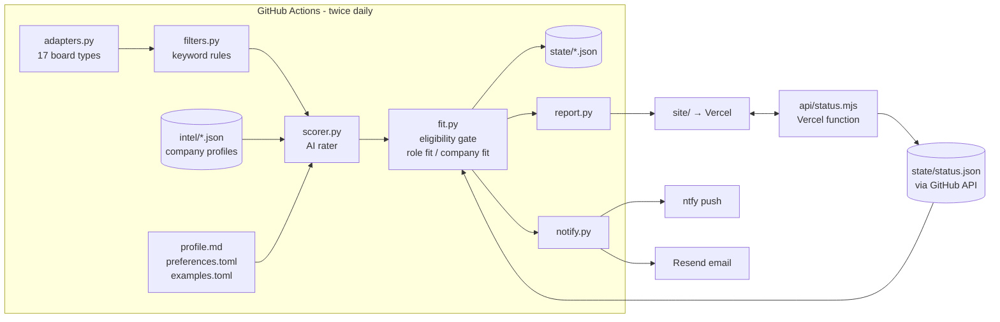

# Job Scanner

> **Retired 19 October 2026.** Replaced by the multi-user
> [job-scanner-app](https://github.com/robbiecharlesschwartz-sudo/job-scanner-app)
> (https://job-scanner-app-mocha.vercel.app). The daily scan is turned off, the old results page
> redirects to the app, and this repository is archived (read-only). To bring it back: unarchive
> the repo, remove `redirects` from `vercel.json`, and re-enable the `daily-scan` workflow.

**A personal recruiting-intelligence tool for one early-career candidate.** Twice a day it reads
the official career sites of ~30 target consulting firms and companies, keeps the early-career
strategy roles a new grad can actually apply for, and explains each one: why the role fits, what
sets the company apart, what the company documents about supporting its people, and what to check
before applying. New matches arrive as free phone alerts; everything lives on one results page.

It runs entirely on free tiers (GitHub Actions, Vercel Hobby, free AI APIs, ntfy) with an
optional paid AI key.

## The problem it solves

Job boards answer "what's open?". A candidate needs to know **"is this worth applying to, and
why this company rather than the five others with the same title?"** A bare "Business Analyst"
title can mean pure strategy at one firm and software implementation at another. Benefits pages
all sound alike, and the details that matter (eligibility, level, travel, how a firm actually
supports people) are spread across postings and policy pages. Job Scanner does that reading every
day, against the candidate's own profile and past judgements, and is explicit about what it knows
and what it doesn't.

## Key features

- **Official sources only.** 17 board adapters (Workday, Greenhouse, Ashby, Lever, Oracle HCM,
  Avature, Radancy, iCIMS Jibe, Phenom, SuccessFactors, and others). No LinkedIn, no aggregators.
- **Hard eligibility kept separate from preferences.** Keyword rules and the AI exclude roles the
  candidate can't apply for (level, degree, location, start date). A great company never rescues
  an ineligible role.
- **Role fit vs company fit.** Strong / Good / Stretch rates the *role*. A separate company-fit
  label (High / Medium / Low / Unknown), weighted by your own priorities, orders matches.
- **Company intelligence, with evidence labels.** A researched profile per company (business,
  differentiators, early-career development, employee support beyond benefits, flexibility,
  trade-offs, unknowns), each finding labelled and sourced. Research is cached, not repeated.
- **Results page:** every open match until its posting closes, Applied / Not interested
  check-offs that sync across devices, closed postings for 30 days, a 30-day scan log, and a
  company-research page.
- **Built to run unattended:** it never closes a posting because a board failed or answered
  only partly; a posting the AI couldn't rate is retried, never lost; state is written
  atomically; alerts are never repeated.


*Rendered from the live state with the new code. This match was rated before the upgrade, so its
company details are company-level research ("About McKinsey"); matches rated from now on also get
job-specific write-ups ("Why McKinsey"), eligibility and company-fit badges.*

## How it works

Each scheduled run, in order:

1. **Fetch** every enabled company's board through its own endpoint, 8 in parallel. A board that
   errors, hits its page limit, or suddenly lists under half its last count is marked
   **incomplete** for this scan.
2. **Skip what's been seen** (`state/seen.json`, keyed `company|job id`), except postings still
   waiting for an AI rating (`state/pending.json`).
3. **Keyword rules** (`settings.toml`) reject senior, off-target, non-NYC, 3+ years, MBA-required
   and wrong-start-date postings. Detail pages are fetched only for title survivors.
4. **AI rating.** Survivors go to the AI in small batches, grouped by company, with the
   candidate's profile, preferences, past verdicts (`examples.toml`) and that company's cached
   profile. Each posting gets eligibility, a role-fit rating, a short write-up and 1-5 company-fit
   scores.
5. **Classify** (`scanner/fit.py`): an eligibility gate, then the role-fit rating with caps, then
   company fit.
6. **Save, then alert.** State is written first, then an email for new Strong matches, the page
   is rebuilt, and finally one phone alert per new match plus a summary.
7. **Track** every match until its posting closes: missing from two complete listings in a row,
   or its posting page returns 404/410.
8. **Upkeep:** `python -m scanner.intel check` re-fetches a few profiles' official pages (no AI
   calls), and `state/` + `site/` are committed, which redeploys the page.

## Architecture



| Component | Role |
|---|---|
| `scanner/adapters.py` | One function per board platform; fetch + normalise only. Flags listings cut off by page limits. |
| `scanner/filters.py` | Deterministic keyword rules: reject / stretch / candidate / clear. |
| `scanner/intel.py` | Loads, validates and renders company profiles; `status` / `check` / `draft` upkeep commands. |
| `scanner/scorer.py` | Prompt, providers (Claude → NVIDIA → Groq), per-rating validation. |
| `scanner/fit.py` | Final classification and company-fit score. |
| `scanner/__main__.py` | The run: completeness checks, retry queue, closures, state, alerts. |
| `scanner/report.py` | Static site: `index.html`, `companies.html`, `log.html`, short links. |
| `scanner/notify.py` | ntfy push and Resend email. |
| `api/status.mjs` | Saves Applied / Not interested marks to `state/status.json`. |

## Company intelligence

Each company has a profile in `intel/<company>.json`, researched once and reused by every scan.
The full methodology and schema are in [`intel/README.md`](intel/README.md).

**What a profile covers:** what the company does and its service lines, differentiators,
early-career development, employee support *beyond* pay and standard benefits (caregiving leave,
return-from-leave programs, mental-health support, firm-wide breaks), flexibility, culture,
trade-offs, unknowns, and every source with its type and dates.

**Evidence labels.** Every finding carries one:

| Label | Meaning |
|---|---|
| Verified policy | The company documents it. It shows the policy **exists**, not that every team practises it. |
| Supporting evidence | Credible independent reporting about how things work in practice. |
| Tentative signal | Indirect, partial, dated, self-reported or review-based. A lead to check. |
| Unknown | No reliable evidence. Never counted against a company. |

**What it does not establish:** how a particular team, office or manager works; whether a
generous policy is applied consistently; anything not in its sources. Hybrid work alone is never
called "flexibility"; marketing statements are labelled as the company's own claims. A company
with thin research is not marked down; its support score is simply left unknown.

**Current state (2026-10-15):** all 30 enabled companies have profiles. They were researched with
web search; the research environment could not open the pages directly, so profiles record
that, and some numbers (especially older leave announcements) are flagged as dated. Profiles
are due for refresh on 2027-04-15; the page marks a profile as possibly out of date after its
refresh date, or if an official page it watches changes.

**Company research vs job scoring.** The profile is *context*. The AI rates the role from the
posting itself, then writes job-specific "Why this company / support / development / check
before applying" notes that may draw on the profile. Where a match has no job-specific note,
the page shows the company-level finding instead, headed "About <company>" and labelled
"(company-level)", so it never claims to explain the specific role.

**Cost controls.** No research happens during scans. Only profiles for companies in the current
batch are sent, each capped at 2,200 characters (`[intel] prompt_chars`), and same-company
postings are batched so a profile is sent once. Claude requests cache the fixed system prompt.
Upkeep checks are hash comparisons of official pages, with no AI calls.

## Role-fit scoring and eligibility

| Rating | Meaning | What to do |
|---|---|---|
| **Strong** | Meets every stated requirement, eligibility confirmed by the posting, squarely on target (entry-level strategy, management or sustainability consulting, or in-house strategy, in NYC). | Apply now and put it first. |
| **Good** | Meets the hard requirements but a step to the side (operations or transformation, rotational, strategic finance, BD), or one detail unconfirmed. | Worth applying; tailor to its angle. |
| **Stretch** | Realistic but a reach (~2 years asked, ambiguous level, specialised industry). | Apply if time allows; network first. |
| **No** | Fails a hard requirement. Never shown. | - |

How the final result is decided (`scanner/fit.py`):

1. **Eligibility gate.** Excluded if the AI finds a hard-requirement miss (`eligibility:
   ineligible`), a graduate degree or prior full-time work required, a start date before ~May
   2027 or a later cohort, or rates it No. Keyword rules already removed the clear-cut cases.
2. **Role fit** = the AI's rating, capped at **Good** when the keyword rules found the role a
   step off-lane, or when eligibility is only "unclear".
3. **Company fit** = weighted mean of four 1-5 scores (learning, support, differentiation,
   motivation), with weights from `preferences.toml`. Unknown scores are left out rather than
   counted as low; the support score is ignored unless the profile has support evidence; with
   fewer than two known scores the label is **Unknown**. Company fit only orders matches within
   the same priority and rating.

`examples.toml` holds your own verdicts on real postings; the AI follows them as precedent but is
told to judge materially different postings on their own facts.

**When the AI is unavailable:** postings with clear early-career evidence appear right away with
a *provisional* keyword rating and are re-rated on later scans. Postings whose level depends on the
AI wait in `state/pending.json` and are retried for up to 4 scans, then shown as provisional
Stretch so nothing on-lane silently disappears. A provisional match that the AI later rates No is
removed (and listed in the scan log).

## Repository structure

```
companies.toml      who to scan: platform, board, priority (add / pause / re-prioritise here)
settings.toml       keyword rules, alert limits, AI model and caps, company-research settings
profile.md          your background and HARD requirements (sent to the AI)
preferences.toml    your PREFERENCES and company-fit weights (blank = not stated)
examples.toml       your verdicts on real postings (precedent for the AI)
intel/              one researched profile per company + methodology (intel/README.md)
scanner/            the Python package (see the architecture table)
api/status.mjs      Vercel function for Applied / Not interested
state/              seen, tracked, pending, runs, status, intel_checks (committed by each run)
site/               the generated results page (deployed by Vercel)
tests/              unit + end-to-end tests (all external calls mocked)
.github/workflows/  daily-scan.yml (the scanner) and tests.yml (CI)
```

## Setup from a clean checkout

Prerequisites: Python 3.12+, Node 20+ (only for the API tests), a GitHub repo, a free Vercel
account, the ntfy phone app.

```bash
git clone https://github.com/robbiecharlesschwartz-sudo/job-scanner && cd job-scanner
python3 -m venv .venv && .venv/bin/pip install -r requirements.txt
.venv/bin/python -m unittest discover -s tests      # 55 tests, no network
node --test tests/status.test.mjs                    # 6 API tests
.venv/bin/python -m scanner.intel status             # company-profile coverage
```

Then:

1. Edit `profile.md`, `preferences.toml` and `companies.toml` for the candidate.
2. Add the GitHub Actions secrets (table below).
3. Import the repo into Vercel (no build step: `vercel.json` serves `site/` and `api/`). Set the
   Vercel environment variables (table below). Put the deployment URL in `settings.toml` → `[site] url`.
4. Subscribe to your `NTFY_TOPIC` in the ntfy app.
5. Run the workflow once by hand with **dry_run** ticked (Actions → daily-scan → Run workflow).

## Configuration

**GitHub Actions secrets** (Settings → Secrets and variables → Actions):

| Secret | Required | Purpose |
|---|---|---|
| `NTFY_TOPIC` | yes | private ntfy topic name (treat it like a password: anyone who knows it can read your alerts) |
| `NVIDIA_API_KEY` | one AI key needed | free key from build.nvidia.com; main free rater (Kimi) |
| `GROQ_API_KEY` | recommended | free key from console.groq.com; backup rater |
| `ANTHROPIC_API_KEY` | optional, paid | Claude rates first when set (`[scoring] model`, default `claude-haiku-5-5`) |
| `RESEND_API_KEY` | optional | email for new Strong matches via Resend's free plan |

With no AI key at all the scanner still runs: clear early-career matches appear as provisional
and everything else waits in the retry queue.

**Vercel environment variables:**

| Variable | Required | Purpose |
|---|---|---|
| `GITHUB_TOKEN` | yes | fine-grained token, **this repo only**, Contents: read and write; used to save marks |
| `STATUS_TOKEN` | optional | blocks status-API requests that don't come from the results page (see Security) |
| `REPO` | no | `owner/name`, defaults to this repo |

**Files:** `settings.toml` (`[scoring] batch_size`, `max_per_run`; `[intel] prompt_chars`,
`check_every_days`, `max_checks_per_run`; `[email]`; `[sms] max_listed`; `[filters]` regexes),
`preferences.toml` (preferences and weights), `companies.toml` (platform fields are documented
at the top of the file; `intel = "<slug>"` points a company at a differently named profile).

## Running locally

```bash
.venv/bin/python -m scanner --dry-run               # fetch + rate, print alerts, write nothing
.venv/bin/python -m scanner --dry-run --only Ramp   # one company
.venv/bin/python -m scanner --no-sms                # write state/site, send no alerts or email
.venv/bin/python -m scanner --check-ai              # which AI provider answers
.venv/bin/python -m scanner --test-email            # email the best open match as a test
.venv/bin/python -m scanner.intel status            # profiles, freshness, problems, gaps
.venv/bin/python -m scanner.intel check --company Deloitte   # re-check one profile's official pages
```

A real run needs outbound access to the career sites; an environment with a restricted network
policy will show every board as failed (and, by design, close nothing).

### Adding a company

1. Find the board its careers page uses and add an entry to `companies.toml` (quick checks: a
   Greenhouse board answers `https://boards-api.greenhouse.io/v1/boards/<board>/jobs`; Ashby
   `https://api.ashbyhq.com/posting-api/job-board/<board>`; Workday URLs look like
   `https://<tenant>.<wdN>.myworkdayjobs.com/<site>`).
2. `python -m scanner --dry-run --only "<Name>"` to see what it finds.
3. Add `intel/<slug>.json` (ask Claude Code: "research <Name> following intel/README.md"), or
   draft one from official pages with `python -m scanner.intel draft "<Name>" <url> ...` and
   review it. Until a profile exists, the scan log lists the company under "No company profile
   yet" and its matches are judged on the posting alone.
4. `python -m unittest discover -s tests` (one test checks every enabled company has a valid profile).

## GitHub Actions and deployment

`daily-scan.yml` runs at 7:23 and 11:47 AM Eastern (off the hour, because GitHub delays busy
`:00` schedules). The second run is a backup and never re-alerts. Runs share a concurrency group,
so they never overlap. Manual runs offer `check_ai`, `test_email` and `dry_run`. A failed run
sends a phone alert. State is committed even if alerts failed; the push retries with a rebase if
a check-off landed meanwhile. `tests.yml` runs both test suites on every code push and PR; it is
separate so a failing test can never block the daily scan.

Vercel redeploys when `site/`, `api/` or `vercel.json` change (`ignoreCommand`), so check-offs
(which only touch `state/status.json`) don't trigger deploys.

## Push and email notifications

- **ntfy:** one alert per new match (title, location, rating, reason, top pointers; tapping
  opens the posting), then a summary that opens the results page. More than `max_listed` (25)
  new matches → the rest are page-only. Transient ntfy errors are retried; a match is alerted only
  when it first enters `tracked.json`, so re-scans, re-ratings and backup runs never repeat it.
- **Email:** new matches with ratings in `[email] ratings` (Strong by default), including the
  "Why <company>" line, via Resend. Missing `RESEND_API_KEY` is noted in the scan log, not fatal.

## Application tracking

Every card has **Applied** and **Not interested** (and Undo). A click calls `/api/status`, which
commits the change to `state/status.json` through the GitHub API (retrying on conflicting
writes), so marks sync across devices and every scan sees them. A marked card moves into its
section immediately, and a notice at the top confirms it with an **Undo** button (keyboard users
land on it). If saving fails, a red notice says why and the card moves back.
"Not interested" cards leave the page 7 days after marking and never re-alert; the mark stays
in `status.json` as the record.

## Security and privacy

- **Status API access.** Check-offs work on every device with no setup: browsers label the
  page's own requests as same-site, and the API accepts those. Requests from anywhere else
  (another website, a script) need `STATUS_TOKEN` in an `X-Status-Token` header when it is set.
  This blocks other sites and casual scripting, but it is **not strong authentication**: someone
  who knows the URL and fakes browser headers could still change marks (they are undoable, and
  every change is a commit in `state/status.json`). The `#token=` link still works if you ever
  want to use the token from a browser.
- The API also refuses cross-site POSTs (Origin check), accepts only `company|id` keys and the two
  statuses, caps the file at 5,000 marks, and never returns GitHub error bodies.
- Only `http(s)` posting links reach the page (a board can't inject `javascript:` links); all text
  is HTML-escaped.
- `GITHUB_TOKEN` should be a fine-grained token limited to this repository's contents. The
  workflow itself uses the built-in Actions token with `contents: write` only.
- **The results page is public but unlisted** (`noindex`). It shows the AI's notes, which mention
  the candidate's background (internship, graduation date). The scan log and `state/` (in this
  public repo) show which jobs were marked. Use a private repo and Vercel password protection
  (a paid feature) if that matters.
- Secrets live only in GitHub/Vercel settings; the scanner's error messages never include the
  ntfy topic. Personal contact details in the repo: the alert address in `settings.toml` and the
  commit-author email in the workflow and `api/status.mjs`.
- Not implemented: rate limiting on the status API (a Vercel Hobby function has no shared store
  for it). The token is the protection.

## Reliability and failure handling

| Failure | Behaviour |
|---|---|
| One board errors | Others carry on; that company is "incomplete": nothing there is closed, listed postings still refresh. |
| One of a company's boards fails (e.g. PwC's two sites) | The whole company is incomplete, not "OK". |
| Board hits its page cap or lists < 50% of last count | Incomplete (scan log shows why). |
| Posting missing from two complete listings, or its page is 404/410 | Closed; kept on the page 30 days. |
| AI provider error / rate limit / outage | Next provider; 429s wait and retry; account errors (401, no credit) stop retrying that provider. |
| Malformed AI output | Each rating validated separately; bad entries dropped, the rest kept; missing ones retried next scan. |
| Per-run AI cap reached | Extra postings wait for the next scan (not dropped). |
| Corrupt `seen.json` / `tracked.json` | The run stops with a restore command (better than forgetting history and re-alerting everything). |
| Corrupt `runs.json` / `pending.json` / `status.json` | Started afresh, noted in the scan log. |
| Crash mid-write | Impossible to leave half a file: writes go to a temp file, then rename. |
| Crash after alerts | State is saved before any alert or email is sent. |
| Overlapping runs | Prevented by the workflow's concurrency group. |
| Company profile invalid | Bad findings are dropped individually; a bad file is skipped; scans continue. |
| Profile stale or its official page changed | Still used; the page and companies page say it may be out of date. |

## Supported platforms and known gaps

Platforms: Greenhouse, Lever, Ashby, Workday, Oracle HCM, Avature (HTML and RSS), Radancy,
iCIMS Jibe, Sourceflow, Yello, Phenom, SuccessFactors, Breezy, plus IBM's, KPMG's and McKinsey's
own search APIs.

Coverage is **not complete** for every company:

- **Big boards are keyword-searched** (`queries` in `companies.toml`), not pulled whole, so roles
  that match none of the queries are missed.
- **Slalom** is read from an RSS feed of ~20 postings with no locations: partial, and never used
  to close postings.
- **EY** is scanned through its US early-careers board; on careers.ey.com only EY-Parthenon roles
  in New York are scanned.
- **Oliver Wyman, Innosight and Strategy&** share parent-company boards (Marsh McLennan, Huron,
  PwC) and are found by name in the title; roles not naming them are missed.
- **Bain, L.E.K., Alvarez & Marsal** block automated requests (Cloudflare). Check them by hand.
- **Persefoni** is disabled: its Greenhouse board returned 404 (2026-10-11 and 2026-10-14).
- Boards change their markup. A broken adapter shows as failed in "Scan details" and the log.
- Company profiles reflect web research on 2026-10-15; several leave figures come from dated
  announcements and are labelled tentative.

## Troubleshooting

| Symptom | Check |
|---|---|
| No phone alerts | Did the run find new matches? (scan log). Is `NTFY_TOPIC` set and subscribed? The run fails (and alerts) if ntfy rejects messages. |
| No email | `[email] to` set? `RESEND_API_KEY` secret? The scan log notes email problems. |
| A company always "failed" | Open "Scan details" for the error; test with `--dry-run --only "<Name>"`; the board may have moved platform. |
| "Incomplete" every scan | Raise `max_pages` for that company, or narrow `queries`. |
| Many "provisional" matches | AI keys missing or exhausted: run the workflow with `check_ai`. |
| "Waiting for an AI rating" keeps growing | Same as above, or `max_per_run` too low for the backlog. |
| Check-offs don't save | A red "Not saved" notice explains why. A 502 means `GITHUB_TOKEN` in Vercel is missing or expired. Marks from another device appear when you return to the tab or reload. |
| A rating looks wrong | Add the posting to `examples.toml` with your verdict and reason. |
| Run stopped: "is not valid JSON" | Run the `git checkout HEAD~1 -- state/<file>` command it prints, commit, re-run. |

## Cost and limitations

| Item | Cost |
|---|---|
| GitHub Actions | Free for public repos (a run takes a few minutes, twice a day). |
| Vercel Hobby | Free (static page + one small function; Hobby terms are for personal, non-commercial use). |
| NVIDIA / Groq AI | Free tiers with rate limits; the scanner waits on 429s and retries. |
| Claude (optional) | Pay-as-you-go. Haiku is cheap at this volume (tens of postings a day after the first backlog); the system prompt is cached. |
| ntfy | Free public server (anonymous rate limits; one second between messages). |
| Resend (optional) | Free plan (3,000 emails/month). |
| Company research | Free per scan (cached files). Refreshing it means a Claude Code session or the free-tier `draft` command. |

No paid database or service was added. Limitations: AI ratings can be wrong (examples.toml is the
fix); company research is a snapshot with labelled confidence, not a verdict on any team; free-tier
AI limits can delay ratings by a scan or two; coverage gaps above.
